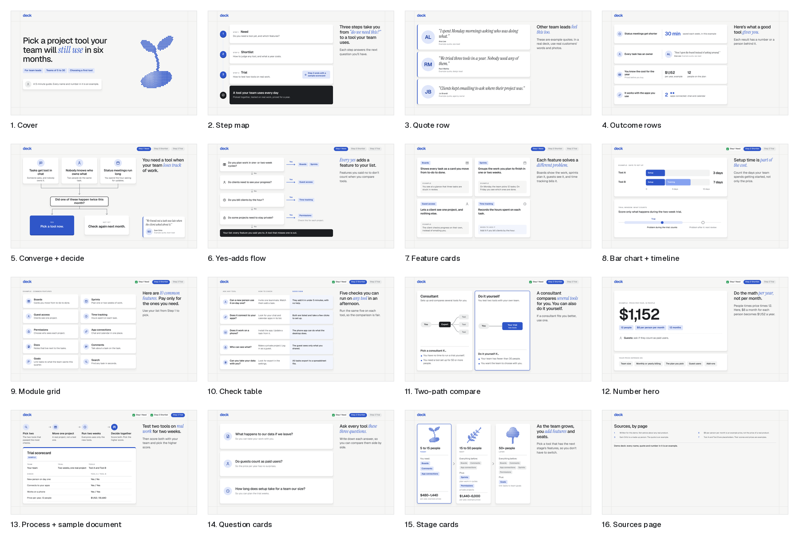

# deck-engine

A small, fixed engine for making PDF decks and guides that people understand on the first read.

You write one Python file that puts together pages from a bank of 16 tested layouts. The engine turns it into a 1280x720 PDF, checks the PDF, and rasterizes every page so you (or Claude) can look at the real output before sending it.



## Why

Most decks are paragraphs on a colored background. People don't read them; they look at them. This engine is built for **visual communication**:

- **The diagram teaches.** Each page leads with a picture of the idea: a flowchart, an if/else tree, a comparison, bars, a timeline, a sample document. The eye lands there first.
- **Words a person would say out loud.** The right-hand column holds one spoken line (30px) and one supporting line (21px), at about a 9th-grade reading level. If it doesn't fit, you write better words, not smaller ones.
- **One question per page.** Each page answers the one question the reader has at that moment, in the order they'll ask it.

The rules are in [SKILL.md](SKILL.md) (short) and [principles.md](principles.md) (with examples).

## Quickstart

Requirements: Python 3.9+, Node 18+, Playwright with Chromium, poppler.

```bash
npm install playwright && npx playwright install chromium
sudo apt-get install poppler-utils        # macOS: brew install poppler
pip install pillow                         # only for rebuilding the component gallery

python3 examples/demo/slides.py            # writes examples/demo/build/deck.html
node engine/render.js examples/demo/build  # writes deck.pdf
python3 engine/check.py examples/demo/build # checks the PDF, writes pages/p-*.png
```

Then open every image in `examples/demo/build/pages/`. The finished demo is in [examples/demo/deck.pdf](examples/demo/deck.pdf).

To try another theme: `python3 examples/demo/slides.py /tmp/warm example-warm.json`.

## The pipeline

```
spec-template.md        fill in: reader, purpose, promise, outcomes, words, the reader's questions in order
      |
      v
slides.py               one file: for each question, pick a component from the bank, pass in words + data
      |                 (import kit, components; kit.load_theme(...); kit.build(...))
      v
build/deck.html
      |
      v
node engine/render.js   Chromium prints one PDF page per <section>
      |
      v
build/deck.pdf
      |
      v
python3 engine/check.py fonts (no Type 3), zero /SMask, JPEG-only images, banned words,
      |                 placeholders; then rasterizes to build/pages/
      v
look at every page PNG  nothing overlaps, overflows or is cut off; visual seen first
      |                 fix the slides file and re-run until it's clean
      v
deliver deck.pdf
```

## What's in the repo

| Path | What it is |
|---|---|
| `SKILL.md` | A Claude skill (`visual-decks`): the procedure and rules, short and imperative |
| `principles.md` | The rules explained, with good and bad examples |
| `spec-template.md` | A fill-in deck spec |
| `engine/kit.py` | The fixed engine: theme, page chrome, step strip, primitives, CSS, `build()` |
| `engine/components.py` | The bank: one function per layout pattern |
| `engine/render.js` | HTML to PDF (Playwright/Chromium) |
| `engine/check.py` | PDF checks + rasterize to `pages/` |
| `engine/fonts/` | Geist (static TTFs) and Instrument Serif Italic, with their licenses |
| `themes/` | `neutral.json` and `example-warm.json` |
| `components/` | Bank catalog (`README.md`), thumbnails, `gallery.png`, `build_gallery.py` |
| `examples/demo/` | An 8-page demo deck: `slides.py`, `deck.json`, `deck.pdf`, `pages/` |

## Make your own theme

Copy `themes/neutral.json` and change `wordmark` (text, drawn in the accent color, or `null`), the colors, and optionally the fonts. To use other fonts, put static `.ttf` files in a folder, set `fonts.font_dir` to it (relative to the theme file), and name the files in `sans_files` / `serif_file`. Use static TTFs, not variable fonts, so the PDF never gets Type 3 fonts.

`steps` is an optional list of step names for the strip at the top of step pages (e.g. `["Need", "Shortlist", "Trial"]`); a deck can also call `kit.set_steps([...])`.

## Rules for changing the engine

- Don't rewrite `kit.py`, `render.js` or `check.py` for one deck. Decks change words and data only.
- Need a layout the bank doesn't have? Write it in your slides file first. Once it works, add it to `components.py`, add a page to `components/build_gallery.py`, and regenerate the thumbnails.
- Keep shadows as stacked **zero-blur** layers (`kit.SHADOW`). A blurred CSS shadow becomes an `/SMask` image in the PDF, and some PDF viewers draw it as a gray box.
- Photos must be JPEGs with no transparency. Everything else (icons, symbols, charts) is SVG or CSS.

## Fonts and license

The code is MIT (see `LICENSE`). The bundled fonts are under the SIL Open Font License 1.1:

- **Geist** by Vercel (The Geist Project Authors): `engine/fonts/OFL-Geist.txt`
- **Instrument Serif** (The Instrument Serif Project Authors): `engine/fonts/OFL-InstrumentSerif.txt`

All names, quotes, prices and scores in the demo and gallery are made up.
