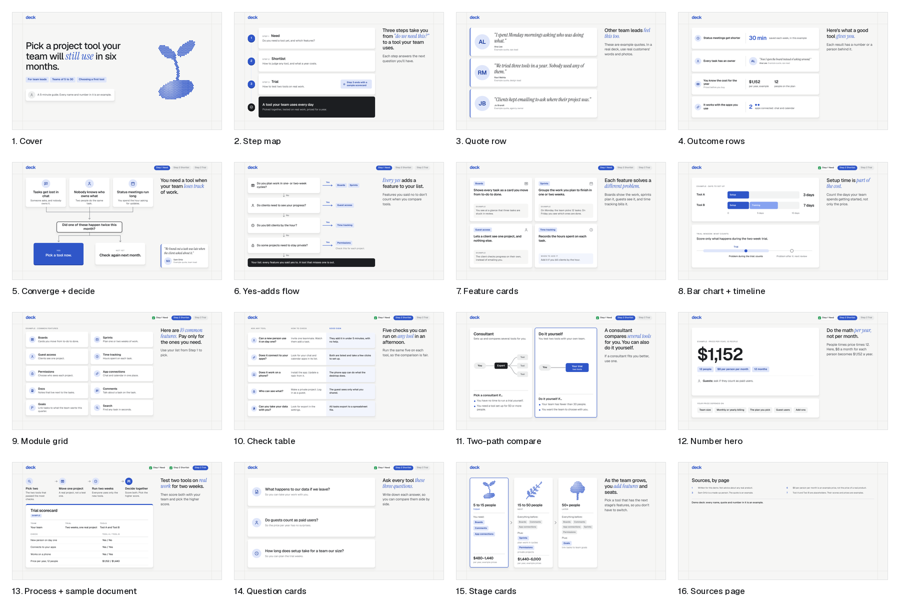

# Component bank

Reuse these. Each one is a function in [`engine/components.py`](../engine/components.py) that takes only words and data and returns one finished page. Primitives (quote card with photo or initials, icons, icon discs, step strip, halftone symbols, column, chips, cards) live in [`engine/kit.py`](../engine/kit.py).

Every teaching component takes `lead`, `sup` (optional), `step` (optional) and, where noted, `quote` (a `kit.quote_card(person, text)` at the bottom of the spoken column).

| # | Component | Use it for (the reader's question) | Function | Thumbnail |
|---|---|---|---|---|
| 1 | **Cover:** headline + growth symbol + "who it's for" tags + byline card | "What is this, and is it for me?" | `cover(headline, symbol, tags, byline)` | [thumbs/01-cover.png](thumbs/01-cover.png) |
| 2 | **Step map:** numbered steps ending at an outcome, with an optional teased payoff | "What will this take me through?" | `step_map(steps, end, lead, sup)` | [thumbs/02-step-map.png](thumbs/02-step-map.png) |
| 3 | **Quote row:** 2-3 quotes with large photos or initials | "Do others feel this way?" | `quote_row(quotes, lead, sup)` | [thumbs/03-quote-row.png](thumbs/03-quote-row.png) |
| 4 | **Outcome rows:** result on the left, evidence on the right | "What will I get?" | `outcome_rows(rows, lead, sup)` + `ev_quote`, `ev_stat`, `ev_stats` | [thumbs/04-outcome-rows.png](thumbs/04-outcome-rows.png) |
| 5 | **Converge + decide:** three triggers flow into one yes/no question | "Do I need this yet?" | `converge_decide(sources, question, yes, no, lead, sup, quote)` | [thumbs/05-converge-decide.png](thumbs/05-converge-decide.png) |
| 6 | **Yes-adds flow:** if/else list where every yes adds chips | "Which of these apply to me?" | `yes_adds_flow(questions, summary, lead, sup)` | [thumbs/06-yes-adds-flow.png](thumbs/06-yes-adds-flow.png) |
| 7 | **Feature cards:** what each option does + a concrete example | "What does each one do?" | `feature_cards(cards, lead, sup)` | [thumbs/07-feature-cards.png](thumbs/07-feature-cards.png) |
| 8 | **Bar chart + timeline:** horizontal bars, optional "what counts" timeline | "How much / how long?" | `bar_chart(title, rows, axis, lead, sup, quote, timeline)` | [thumbs/08-bar-chart.png](thumbs/08-bar-chart.png) |
| 9 | **Module grid:** up to 10 options as an icon grid | "What options exist?" | `module_grid(items, lead, sup, label)` | [thumbs/09-module-grid.png](thumbs/09-module-grid.png) |
| 10 | **Check table:** ask / how to check / answer or good sign | "How do I judge my options?" | `check_table(headers, rows, lead, sup)` | [thumbs/10-check-table.png](thumbs/10-check-table.png) |
| 11 | **Two-path compare:** two options, small diagrams, honest "Pick X if..." | "A or B?" | `two_path_compare(left, right, lead, sup)` + `fan_diagram`, `direct_diagram` | [thumbs/11-two-path-compare.png](thumbs/11-two-path-compare.png) |
| 12 | **Number hero:** one big number + what it includes + what drives it | "What will it cost / take?" | `number_hero(label, number, lead, sup, chips_row, note, drivers)` | [thumbs/12-number-hero.png](thumbs/12-number-hero.png) |
| 13 | **Process + sample document:** 3-4 actions above a sample of the result | "How do I do it?" | `process_doc(steps, doc, lead, sup, quote)` | [thumbs/13-process-doc.png](thumbs/13-process-doc.png) |
| 14 | **Question cards:** three questions to bring, each with why | "What should I ask?" | `question_cards(questions, lead, sup)` | [thumbs/14-question-cards.png](thumbs/14-question-cards.png) |
| 15 | **Stage cards:** 2-3 stages with growth symbols, carried-over chips and a value | "What changes as we grow?" | `stage_cards(stages, lead, sup)` | [thumbs/15-stage-cards.png](thumbs/15-stage-cards.png) |
| 16 | **Sources page:** every fact's source, by page number | Last page | `sources_page(rows, title, closing)` | [thumbs/16-sources-page.png](thumbs/16-sources-page.png) |

## Adding a component

1. Write it in your slides file first, with `kit` primitives and `kit.C[...]` colors (never hex codes).
2. When it works, move it into `engine/components.py` with all words and data as arguments.
3. Add an example page to `components/build_gallery.py` (`BANK` list).
4. Regenerate: `python3 components/build_gallery.py && node engine/render.js components/build && python3 engine/check.py components/build && python3 components/build_gallery.py --thumbs`
5. Add a row to this table.

If a piece is used by two or more components, make it a primitive in `kit.py`.
